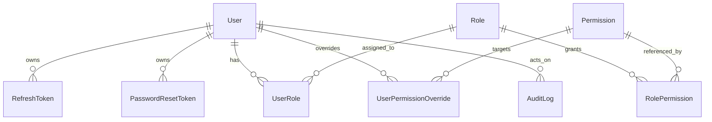

# Architecture

Production-ready NestJS RBAC API starter. Modular monolith, strict TypeScript, TDD, server-side dynamic authorization.

## Locked Dependency Matrix

Verified against the npm registry and official docs (Nov 2026):

| Package             | Pinned                   | Note                                                                                                                                                                                                        |
| ------------------- | ------------------------ | ----------------------------------------------------------------------------------------------------------------------------------------------------------------------------------------------------------- |
| Node                | >= 22 (CI/dev on 24 LTS) | Nest 12 engines: `>= 20`                                                                                                                                                                                    |
| @nestjs/*           | 12.3.2                   | All framework packages on the same minor                                                                                                                                                                    |
| TypeScript          | **6.0.3**                | TS 7.0.2 exists and supports `emitDecoratorMetadata`, but `@nestjs/cli` 12 still bundles `typescript ~6.0.2` and its programmatic commands fail under TS 7 (nestjs/nest-cli#3479). Revisit when that lands. |
| Module system       | ESM (`"type": "module"`) | Nest 12 is ESM-native                                                                                                                                                                                       |
| Prisma              | **7.10.1**               | Registry `latest` tag points at 8.0.0-rc — intentionally skipped until v8 is GA and stable                                                                                                                  |
| Zod                 | 4.6.7                    | Via Nest 12 Standard Schema validation                                                                                                                                                                      |
| @node-rs/argon2     | 2.2.2                    | Fallback: `argon2` if no prebuilt binary for the platform                                                                                                                                                   |
| @nestjs/jwt         | 12.0.3                   |                                                                                                                                                                                                             |
| @nestjs/swagger     | 12.1.0                   |                                                                                                                                                                                                             |
| @nestjs/config      | 12.0.1                   |                                                                                                                                                                                                             |
| @nestjs/throttler   | 6.7.1                    |                                                                                                                                                                                                             |
| Vitest              | 5.1.0                    | + @vitest/coverage-v8                                                                                                                                                                                       |
| Testcontainers      | 12.2.1                   | @testcontainers/postgresql + @testcontainers/mysql                                                                                                                                                          |
| supertest           | 7.3.1                    |                                                                                                                                                                                                             |
| helmet              | 8.3.0                    |                                                                                                                                                                                                             |
| rxjs                | ^7 (Nest peer)           |                                                                                                                                                                                                             |
| ESLint (type-aware) | current stable           | Source of truth. Oxlint optional fast pass only — not type-aware, cannot be the sole gate.                                                                                                                  |

Policy: caret within verified-compatible matrix, committed lockfile (pnpm), Dependabot grouped monthly. CI installs frozen lockfile.

## Approved Decisions

1. **Primary keys** — `cuid` strings for `User`, `Role`, `Permission` (avoids ID enumeration hints); int autoincrement for join tables (`UserRole`, `RolePermission`, `UserPermissionOverride` composite PK) and `RefreshToken`/`PasswordResetToken`; `bigint` for `AuditLog`.
2. **Package manager** — pnpm, `packageManager` field pinned.
3. **`@RequirePermissions` default mode** — **AND** (fail-closed). `{ mode: 'or' }` opt-in.
4. **Access-token compromise tail** — 15-min TTL accepted; logout-all revokes all refresh families immediately. jti denylist documented as extension point, not built (no Redis in a starter).
5. **Refresh token transport** — `httpOnly; Secure; SameSite` cookie primary; JSON body fallback documented for non-browser clients.
6. **INHERIT semantics** — represented by absence of a `UserPermissionOverride` row (resetting an override deletes it).
7. **Audit** — no update/delete API surface; redaction at write time; DB-level append-only grants documented for production.

## Layers & Rules

```
HTTP → ThrottlerGuard → JwtAuthGuard → PermissionsGuard → Controller (thin)
     → Service (business logic, authorization cross-checks)
     → Repository (Prisma) → DB
```

- Access tokens carry `sub`/`sid`/`jti` only — **never permissions**. `PermissionsGuard` loads current server-side effective permissions per request (in-process cache invalidated by every RBAC mutation), so revocation and account deactivation take effect immediately.
- Deny-by-default: a global route-tree scan at bootstrap fails startup if any non-`@Public()` route lacks `@RequirePermissions` metadata.
- Controllers never return Prisma records — explicit whitelisted view models prevent secret leakage.
- Pluggable `MailerPort` for password-reset delivery; `ConsoleMailer` in dev.

## Entity Relationships



Fields (condensed — full schema lives in `prisma/schema.*.prisma`):

- **User**: id(cuid), email(unique, stored lowercase), passwordHash, firstName, lastName, status(ACTIVE|DISABLED|LOCKED), failedLoginCount, lockedUntil, passwordChangedAt, timestamps
- **Role**: id, name(unique), description, isSystem, timestamps
- **Permission**: id, key(`resource.action`, unique), name, description, resource, action, timestamps
- **UserRole** / **RolePermission**: composite unique (userId,roleId) / (roleId,permissionId)
- **UserPermissionOverride**: (userId, permissionId) unique, effect(ALLOW|DENY)
- **RefreshToken**: id, tokenHash(sha256, unique), userId, familyId, expiresAt, revokedAt, createdIp, createdByUserAgent
- **PasswordResetToken**: id, tokenHash(unique), userId, expiresAt, usedAt
- **AuditLog**: id(bigint), actorUserId(nullable), action, resourceType, resourceId, changes(JSON, redacted), ip, userAgent, createdAt

## Dual-Database Strategy

`prisma/schema.postgresql.prisma` + `prisma/schema.mysql.prisma`; identical except the `provider` line and type-mapping directives. `db:use:postgres|mysql` scripts validate parity and select the active schema; client generated to one path (`src/generated/prisma`) so app code is provider-agnostic. CI runs a normalized schema-parity diff and the E2E matrix on both engines.

Portability rules: no Postgres-only types (jsonb, arrays, citext), no partial indexes; email case-insensitive uniqueness via lowercase normalization, not collation.

## Authentication Flow

```mermaid
sequenceDiagram
    participant C as Client
    participant A as Auth API
    participant D as DB
    C->>A: POST /auth/login
    A->>A: throttled; argon2id verify; status + lockout check
    alt invalid
        A->>D: failedLoginCount++, maybe lockedUntil
        A->>C: 401 (uniform message, no enumeration) + audit LOGIN_FAILURE
    else valid
        A->>D: reset counter; issue RefreshToken (hashed, familyId, 14d)
        A->>C: accessJwt (15m) + httpOnly refresh cookie + audit LOGIN_SUCCESS
    end
    C->>A: POST /auth/refresh
    A->>D: lookup by hash; expiry/revocation check
    alt reused rotated token
        A->>D: revoke whole family + audit
        A->>C: 401
    else ok
        A->>D: revoke old, issue new in same family
        A->>C: fresh pair
    end
    C->>A: protected request (Bearer)
    A->>A: validate sig+iss+aud+exp+jti, then per-request status + CURRENT permissions
    A->>C: 401 / 403 / 200
```

## Permission Evaluation Algorithm

Centralized in `PermissionEvaluator`; guards/controllers never duplicate it.

```
evaluate(user, required[], mode AND|OR):
 1. user.status !== ACTIVE                 → deny (403)
 2. user has isSystem SUPER_ADMIN role     → allow all
 3. rolePerms = ⋃ permissions(assigned roles)
 4. effective = (rolePerms ∪ ALLOW_overrides) \ DENY_overrides
 5. AND: required ⊆ effective | OR: required ∩ effective ≠ ∅
 6. otherwise deny
```

Properties (each covered by tests): DENY beats every role ALLOW; ALLOW grants without any role; INHERIT = row deleted → inheritance restored; role changes propagate to all members; one user's overrides never affect another; empty evaluation denies.

## Security Threat Model

| Threat                            | Mitigation                                                                                                                                         |
| --------------------------------- | -------------------------------------------------------------------------------------------------------------------------------------------------- |
| Credential stuffing / brute force | Throttler on auth routes (IP + identity), argon2id, progressive lockout (`failedLoginCount`/`lockedUntil`)                                         |
| Lockout-as-DoS                    | Residual, documented; count+window based; admin reset; CAPTCHA extension point                                                                     |
| User enumeration                  | Identical 401 across wrong-email/wrong-password/disabled; forgot-password always 202                                                               |
| Secret leakage                    | Passwords/refresh/reset tokens hashed at rest; view-model projections; audit redaction; CI secret scan                                             |
| Stolen refresh token              | Rotation, sha256 at rest, family reuse detection → whole-family revocation                                                                         |
| JWT forgery/replay                | Explicit iss/aud/exp/jti validation, ≥256-bit secrets from env only, 15-min TTL                                                                    |
| Privilege escalation              | isSystem role/user protected; grant-scope rule (cannot grant permissions you lack, cannot touch Super Admin); deny-by-default + startup route scan |
| IDOR                              | Service-layer ownership or `users.*` permission checks on every resource access                                                                    |
| Audit tampering                   | No mutation endpoints; docs recommend append-only DB grants in production                                                                          |
| Template unsafe defaults          | Prod startup fails on missing/placeholder secrets                                                                                                  |

## Known Conflicts & Resolutions

- "Immediate revocation" vs stateless JWT → per-request server-side authz/status checks give full immediacy for permissions and deactivation; access-token tail bounded to 15 min (Decision 4).
- "TypeScript 6+" vs TS 7 → 6.0.3 satisfies the floor; 7 blocked by nest-cli (tracked above).
- "Configurable roles" vs fixed Super Admin → only the isSystem SUPER_ADMIN identity is protected; all other roles are seed data.

## Project Structure

```
src/
  common/{decorators,guards,filters,interceptors,pipes,dto,models,constants}
  config/
  database/prisma/  database/seeds/
  modules/{auth,users,roles,permissions,audit-logs}/
    each: controllers/ services/ dto/ (auth also: guards/ strategies/ interfaces/)
test/{unit,integration,e2e}/
prisma/{schema.postgresql.prisma, schema.mysql.prisma, migrations/, seeds/}
```

## Roadmap

Phase 2 scaffold → 3 auth → 4 roles/permissions/seed → 5 engine+guards → 6 overrides → 7 user admin+audit → 8 full E2E on both DBs + Swagger → 9 CI/Docker/docs/template. Every feature starts with a failing test; mock-only tests are never a substitute for testcontainers-backed integration/E2E coverage.
